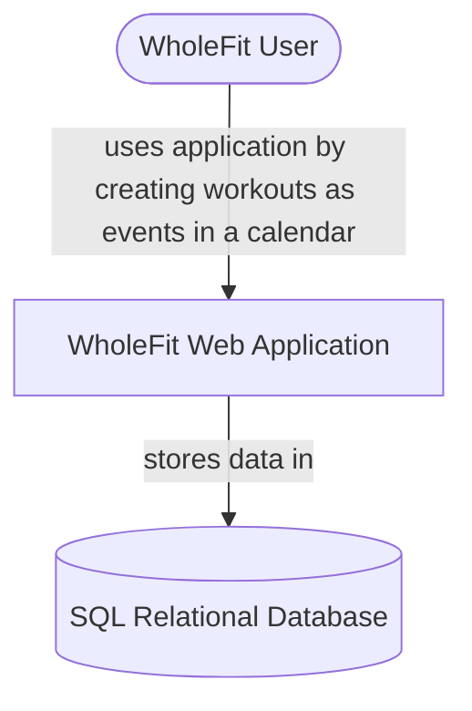
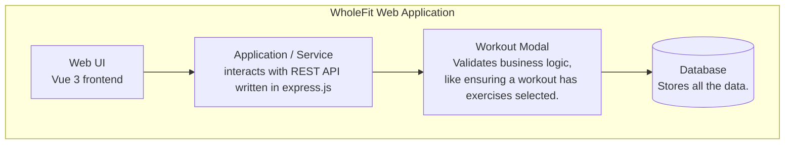
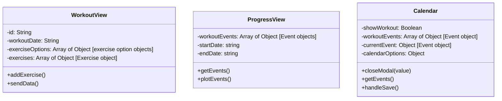
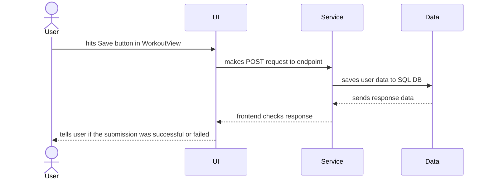

# WholeFit

<!-- CI badge: after Session 4, replace ORG/REPO and the workflow filename, then uncomment:

-->
[](https://github.com/GoldLion72/cen5064-project-lusbel/actions/workflows/node-ci.yml)

**Student:** [Josecarlos Lusbel] · **Course:** CEN 5064 Software Design, Fall 2026 · **Partner:** [@JaiKaushik03]
 
## Project (approval paragraph — write this by Sun Aug 30)

<!--[One paragraph: What is the system? Who is it for? What are its 3–4 core features?
This paragraph is your approval request — see the Project Brief, Section 2.]-->

This project will be focused on creating a web application that allows users to track their fitness progress. Anyone who is interested in tracking their fitness regimen can use this app. The current planned core features for this project are allowing the user to create a workout, allowing them to schedule their created workout, and having the web app inform them if they are making any progress (they spent more time exercising this week than the previous week, for example).

## How to run
Prerequisites: Install git, and the latest version of Node on your machine.

Open up a terminal and run the following commands:
```
git clone https://github.com/GoldLion72/cen5064-project-lusbel.git
cd cen5064-project-lusbel
```
This project is a web application, so there is a backend component and a frontend component.
You need to run the backend first, otherwise the frontend won't be able to make any API calls.

### Backend
In your terminal, run the following commands:
```
cd backend
npm install
npm test
npm run dev
```

### Frontend
Open up another terminal and go back to the directory in which you cloned the project in and run this command:
```
cd cen5064-project-lusbel
```
In your terminal, run the following commands:
 ```
  cd frontend           
  npm install                    
  npm test
  npm run dev                       
```

After the frontend is running, open up the localhost link in a browser to see the application.

## Architecture

### Tier breakdown (Session 2 studio)

| Tier | Responsibilities in THIS system |
|------|--------------------------------|
| Presentation | WorkoutView – modal where the user can fill out the details of their workout. CalendarView – allows the user to create an event and view all the events they have created. ProgressView – shows user if they have progressed |
| Service | getEvents() – responsible for retrieving all the events that will be used in the presentation to load the events, through an API call. handleSave() – responsible for making an API call with the data that needs to be saved. Also returns the workout event that was newly created. |
| Domain | Workout – must have at least 1 exercise chosen. Progress – a user makes progress if, for example, the number of sets of a certain exercise, increases within the specified date range. |
| Data | retreiveEvents() – gets all the workout events stored in the database via SQL queries. getEvent()- responsible for retrieving an event with a certain event ID using SQL queries. insertEvent() – responsible for inserting a workout event in the database using SQL queries. |

### C4 — Context & Container (Session 3 studio)





### UML — Class & Sequence (Session 3 studio)





## Architecture Decision Records

Decisions live in [`docs/adr/`](docs/adr/). Start with ADR-001 in Session 4.

| # | Decision | Status |
|---|----------|--------|
| [001](docs/adr/adr-001.md) | What is being built | proposed |
| [002](docs/adr/adr-002.md) | Use Vue Framework instead of React | proposed |
| [003](docs/adr/adr-003.md) | Using SQLite over MySQL or Postgres | proposed |

## Weekly log (optional but recommended)

A one-line note per week keeps your commit story readable:

- Week 1 (Aug 24): repo created, three ideas drafted
- Week 2 (Aug 31): ...
- Week 6 (Sep 21): Working on Add a login page to the website #1, where the user will be able to create and account, login, and afterwards they will be able to use the site by adding workouts to a calendar, and seeing their progress.
- Week 7 (Sep 28): created a new issue (#3-implement-routing-functionality) to include routing using Vue Router. Used Claude to try and see if AI could help generate the code as prompted.
