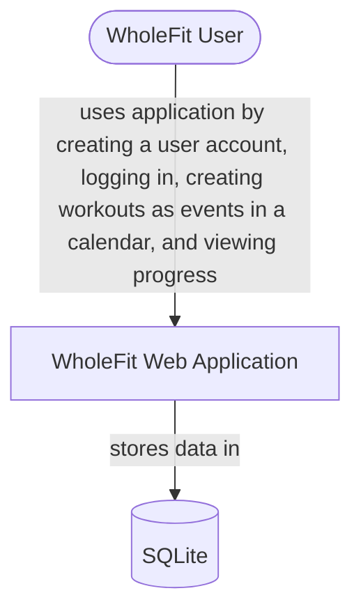
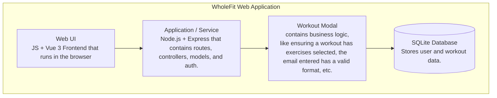
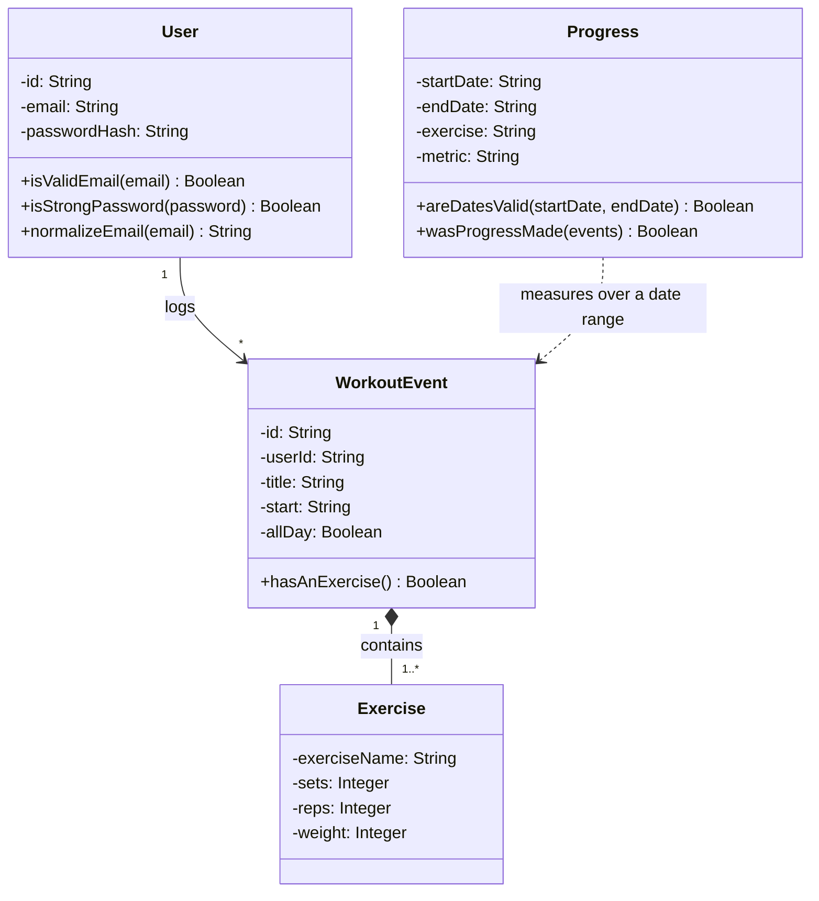
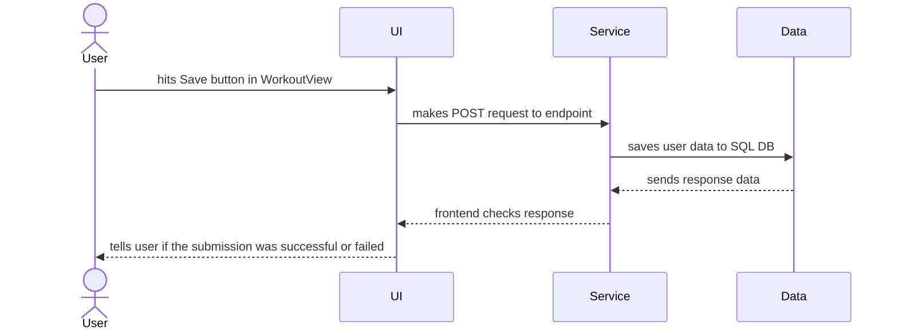

# WholeFit

<!-- CI badge: after Session 4, replace ORG/REPO and the workflow filename, then uncomment:

-->
[](https://github.com/GoldLion72/cen5064-project-lusbel/actions/workflows/node-ci.yml)

**Student:** [Josecarlos Lusbel] · **Course:** CEN 5064 Software Design, Fall 2026 · **Partner:** [@JaiKaushik03]
 
## Project (approval paragraph — write this by Sun Aug 30)

<!--[One paragraph: What is the system? Who is it for? What are its 3–4 core features?
This paragraph is your approval request — see the Project Brief, Section 2.]-->

This project will be focused on creating a web application that allows users to track their fitness progress. Anyone who is interested in tracking their fitness regimen can use this app. The current planned core features for this project are allowing the user to create a workout, allowing them to schedule their created workout, and having the web app inform them if they are making any progress (they spent more time exercising this week than the previous week, for example).

## How to run
Prerequisites: Install git, and the latest version of Node on your machine. The CI file uses Node 22 and 24, so those should work as well. 
NOTE: The `npm install` command in the backend may fail for the `better-sqlite3` dependency, because it requires a C++ toolset. To resolve this issue on Windows, install the Visual Studio Build Tools with the "Desktop development with C++" workload (and Python 3). Afterwards, try running `npm install` in the backend directory again.

Open up a terminal and run the following commands:
```
git clone https://github.com/GoldLion72/cen5064-project-lusbel.git
cd cen5064-project-lusbel
```
This project is a web application, so there is a backend component and a frontend component.
You need to run the backend first, otherwise the frontend won't be able to make any API calls.

### Backend
In your terminal, run the following commands:
```
cd backend
npm install
npm test
npm run dev
```

### Frontend
Open up another terminal and go back to the directory in which you cloned the project in and run this command:
```
cd cen5064-project-lusbel
```
In your terminal, run the following commands:
 ```
  cd frontend           
  npm install                    
  npm test
  npm run dev                       
```

After the frontend is running, open up the localhost link in a browser to see the application.

## Architecture

### Tier breakdown (Session 2 studio)

| Tier | Responsibilities in THIS system |
|------|--------------------------------|
| Presentation | `App.vue` – navbar with the logged-in user, Log out button, and side menu. `LoginView.vue` – login form. `CreateAccountView.vue` – sign-up form. `CalendarView.vue` – calendar showing the user's workouts; add and delete workouts. `WorkoutView.vue` – modal for entering a workout's exercises. `ProgressView.vue` – pick a date range, exercise, and metric to see if progress was made. `ProgressChart.vue` / `LineChart.vue` / `BarChart.vue` – chart the progress results. `NotificationModal.vue` – shows success and error messages. `router/authGuard.js` – sends logged-out users to the login page. |
| Service | **Frontend:** `apiClient.js` – one place for the API URL; sends the auth cookie. `authApi.js` – register, login, logout, and current-user calls. `useAuth.js` – shared login state. `useLogin.js` / `useCreateAccount.js` – form logic for login and sign-up. `useEvents.js` – get, save, and delete workouts. `useProgress.js` – search progress data. **Backend:** `routes/*.js` – map URLs to controllers. `requireAuth.js` – checks the login cookie. `authController.js` / `eventsController.js` / `progressController.js` – handle HTTP requests and responses. `authService.js` – registration and login logic. `passwordHasher.js` – hashes passwords (bcrypt). `tokenService.js` – creates and checks JWTs. |
| Domain | `domain/workout.js` – a workout needs at least one exercise with valid sets, reps, and weight. `domain/progress.js` – date range must be valid; progress is made when the last value is greater than the first. `domain/account.js` – valid email, password of at least 8 characters with a letter and a number, emails stored in lowercase. |
| Data | `db/index.js` + `schema.sql` – SQLite connection and the `USERS`, `EVENT`, and `EVENT_EXERCISES` tables. `usersModel.js` – find and insert users. `eventsModel.js` – get, insert, and delete workouts for the logged-in user; inserts and deletes run in a transaction. `progressModel.js` + `ProgressExerciseFactory.js` – pick the right query (`SetsExercises`, `RepsExercises`, or `WeightExercises`) for the chosen metric. |

### C4 — Context & Container (Session 3 studio)





### UML — Class & Sequence (Session 3 studio)





## Architecture Decision Records

Decisions live in [`docs/adr/`](docs/adr/). Start with ADR-001 in Session 4.

| # | Decision | Status |
|---|----------|--------|
| [001](docs/adr/adr-001.md) | What is being built | proposed |
| [002](docs/adr/adr-002.md) | Use Vue Framework instead of React | proposed |
| [003](docs/adr/adr-003.md) | Using SQLite over MySQL or Postgres | proposed |

## Weekly log (optional but recommended)

A one-line note per week keeps your commit story readable:

- Week 1 (Aug 24): repo created, three ideas drafted
- Week 2 (Aug 31): ...
- Week 6 (Sep 21): Working on Add a login page to the website #1, where the user will be able to create and account, login, and afterwards they will be able to use the site by adding workouts to a calendar, and seeing their progress.
- Week 7 (Sep 28): created a new issue (#3-implement-routing-functionality) to include routing using Vue Router. Used Claude to try and see if AI could help generate the code as prompted.
